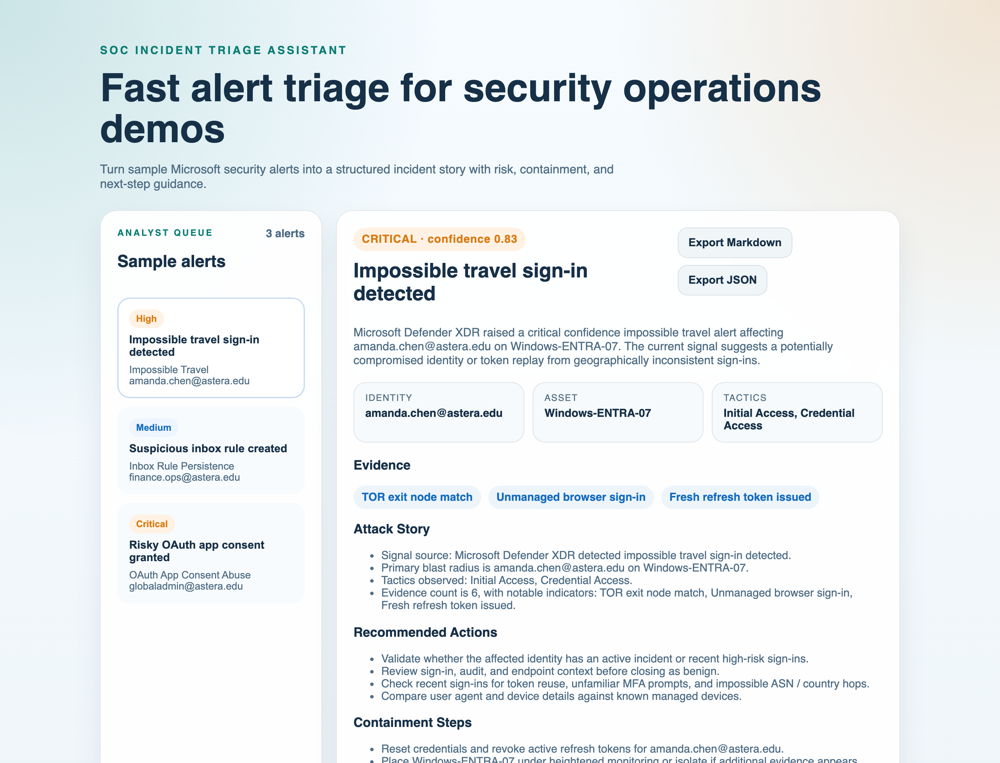

# SOC Incident Triage Assistant

A portfolio project for security operations teams that turns raw alert context into a fast, recruiter-friendly triage experience.

<p>
  
  
  
</p>

## Preview



## Why This Project

`SOC Incident Triage Assistant` is designed to showcase the overlap between cloud security, incident response, and applied AI product thinking.

This starter focuses on:

- ingesting alert payloads from a local sample set
- generating a deterministic triage summary
- surfacing containment actions and investigation next steps
- giving analysts a lightweight browser UI for demos

## Current Starter Scope

- Local web app using Python standard library only
- Sample alerts inspired by Microsoft security workflows
- Deterministic triage engine for repeatable demos
- Actionable recommendations, containment steps, and KQL suggestions
- Markdown and JSON incident brief export
- Unit tests for core triage logic

## Run Locally

```bash
cd path/to/soc-incident-triage-assistant
python3 -m app.server
```

Then open:

```text
http://127.0.0.1:8090
```

## Project Structure

- `app/server.py` local web server and JSON endpoints
- `app/models.py` alert and triage report data structures
- `app/triage_engine.py` deterministic triage logic
- `data/sample_alerts.json` demo input alerts
- `web/index.html` and `web/styles.css` lightweight UI
- `docs/architecture.md` architecture and roadmap
- `tests/test_triage_engine.py` unit tests

## Next Milestones

1. Add Azure Sentinel / Defender export adapters
2. Add analyst feedback loop and case disposition tracking
3. Add LLM-backed narrative mode with grounded evidence prompts
4. Add watchlist enrichment and entity timeline view

## License

Released under the MIT License. See `LICENSE`.
